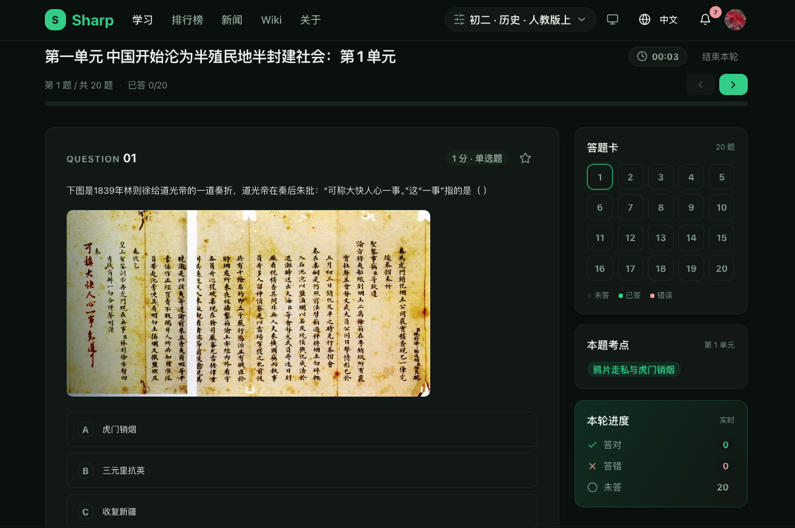

# Sharp

面向 K12 与备考场景的答题学习产品：结构化题库 + 按章节/知识点练习 + 学习记录与排行 + 养成式宠物激励。同一套后端支撑 Web、移动端与后台三端。

## 特征

- **中英文双语**：提供简体中文和英文界面，可根据个人偏好切换，适应不同语言环境。
- **Dark / Light 主题**：支持暗色与亮色主题，兼顾夜间学习、日常阅读等不同使用场景。
- **覆盖 K12 学段**：覆盖小学、初中和高中阶段，支持按学段、学科筛选匹配的学习内容。
- **贴合实际教材**：题库按照教材版本、册次和章节组织，便于结合课堂内容同步练习。
- **章节与知识点双路径**：既可以沿教材章节系统学习，也可以围绕具体知识点专项练习、查漏补缺。
- **学习结果智能分析**：汇总答题记录、正确率与排行数据，直观呈现学习表现，辅助定位薄弱环节并安排针对性复习。
- **宠物陪学**：将学习过程与宠物养成结合，通过宠物成长、动作反馈和互动激励，让长期练习更有趣、更有持续性。

## 预览



## 在线访问

[https://sharp.whoitao.top/](https://sharp.whoitao.top/)

## 移动端构建

```bash
cd apps/mobile
npx expo run:ios            # 或 pnpm ios
npx expo run:android        # 或 pnpm android
eas build --platform android --profile preview   # development / preview / production
```

## 验证

当前仓库没有自动化测试套件，改动以类型检查为准：

```bash
cd apps/admin  && pnpm exec tsc --noEmit
cd apps/web    && pnpm exec tsc --noEmit
cd apps/mobile && pnpm exec tsc --noEmit
cd packages/shared && pnpm typecheck
```

## 相关文档

- [docs/PRD.md](file:///Users/liuchangtao/Projects/whoitao/github/sharp/docs/PRD.md) — 产品需求与整体架构
- [docs/account-and-settings.md](file:///Users/liuchangtao/Projects/whoitao/github/sharp/docs/account-and-settings.md) — 账号与设置
- [docs/subject-stage-filtering-plan.md](file:///Users/liuchangtao/Projects/whoitao/github/sharp/docs/subject-stage-filtering-plan.md) — 学科 / 学段筛选
- [docs/first-login-scope-hint-plan.md](file:///Users/liuchangtao/Projects/whoitao/github/sharp/docs/first-login-scope-hint-plan.md) — 首次登录教材选择引导
- [apps/mobile/README.md](file:///Users/liuchangtao/Projects/whoitao/github/sharp/apps/mobile/README.md) — 移动端目录结构
